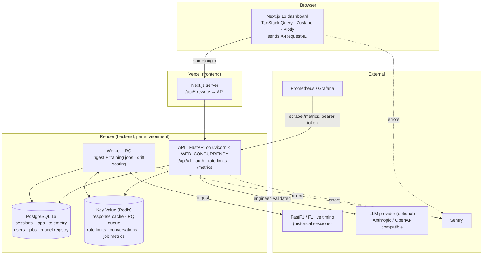

# Architecture

RaceIQ compares two F1 laps distance-aligned, explains where the time goes corner by corner, forecasts tyre degradation for race stints, and lets an AI race engineer summarise the result. The engineer is constrained to the computed facts by a validator. This page shows how the parts fit together; each part's details are linked.

## Request path: a comparison

1. **The browser** posts `/api/v1/comparisons` to its own origin. Next.js rewrites it to the API, so the refresh cookie stays first-party.
2. **The API** (`app/api/routes/comparisons.py` → `app/api/services.py`):
   - Assigns or accepts the request id and binds it into the logs.
   - Applies the per-IP and per-user rate limits.
   - Looks up the response cache, keyed by session, laps and resolution, and dropped when the session is re-ingested. Single-flight: identical concurrent requests compute once.
3. **On a miss:** the processing pipeline (`app/processing/`) loads both laps' telemetry, resamples them onto a common distance grid, integrates the time delta, splits sectors and corners, and derives the findings. The response is cached, pre-gzipped.
4. **Typical latency:** a hit takes about 23 ms at p50 under load (loadtests/README.md).

## Data path: ingest

1. **An admin requests an ingest** (`POST /sessions/{key}/ingest` → 202 with a job URL).
2. **The worker** runs the job (`app/jobs/`) through FastF1 (`app/ingestion/`): normalise, validate laps, store in Postgres (`app/storage/postgres.py`, one transaction per session), invalidate the session's cache entries.
3. **For a race,** the worker also scores the production tyre model on it (drift).
4. **Job status, progress and errors** live in `ingest_jobs`. Transient failures retry with backoff.

## The AI race engineer

The engineer turns a comparison into text without inventing anything:
1. **FactSheet.** A versioned set of computed facts (`app/ai/factsheet.py`).
2. **Prompt.** The LLM writes from those facts only (`app/ai/prompts.py`).
3. **Validator.** It rejects ungrounded numbers, ungrounded labels and unsupported causal claims (`app/ai/validator.py`).
4. **Retry, then template.** One retry; if the draft still fails, the validated template is served (`docs/fallback_templates.md`).
5. **No key.** Without an LLM key the template is always served.

Specs: [factsheet_spec.md](factsheet_spec.md), [validator_rules.md](validator_rules.md), [prompts.md](prompts.md), [qa_behavior.md](qa_behavior.md).

## Tyre model

A pooled fixed-effects degradation model, anchored on each stint's recent laps, with split-conformal prediction intervals, chosen against persistence and tree baselines in Phase 6 ([tire_model_report.md](tire_model_report.md)):
- **Registry.** Artifacts are versioned in `models/registry.json` with SHA-256 checksums verified on load.
- **Serving.** In production the registry is baked into the image.
- **Gates.** A weekly CI job retrains on a fixed dataset and fails on a > 10% MAE regression.
- **Drift.** In production, drift is measured on every newly ingested race ([monitoring.md](monitoring.md#metrics)).

## Code map

| Path | What |
|---|---|
| `backend/app/api/` | v1 routes, schemas, error envelope, request-context middleware |
| `backend/app/processing/` | alignment, delta, sectors, corners, findings |
| `backend/app/ingestion/`, `app/storage/` | FastF1 client (the only FastF1 import), Parquet and Postgres repositories |
| `backend/app/jobs/` | job store, runner (retries), RQ / thread / inline queues, worker |
| `backend/app/ai/` | FactSheet, prompts, validator, guarded generation, Q&A, metrics |
| `backend/app/tires/` | dataset, models, evaluation, registry, serving, drift |
| `backend/app/auth/`, `app/ratelimit.py` | argon2id accounts, JWT access + rotating refresh cookie, token buckets |
| `backend/app/observability.py` | JSON logs, Prometheus metrics, Sentry |
| `backend/alembic/` | migrations (expand-only) |
| `frontend/src/` | dashboard, typed API client generated from `backend/openapi.json`, telemetry |
| `models/` | the tyre model registry (served artifacts + checksums) |
| `monitoring/` | Prometheus alert rules (+ unit tests), Grafana dashboard |
| `ops/` | backup, restore drill, rollback drill |
| `render.yaml`, `.github/workflows/` | infrastructure (Render Blueprint), CI, deploy, weekly ML regression |

## Decisions and references

- [decisions.md](decisions.md): every significant choice and deviation, by phase.
- [deployment.md](deployment.md): platforms and the delivery pipeline.
- [security.md](security.md): auth, cookies, rate limits, threat model.
- [api.md](api.md): the endpoint reference.
- [limitations.md](limitations.md): what the data and models cannot tell you.
