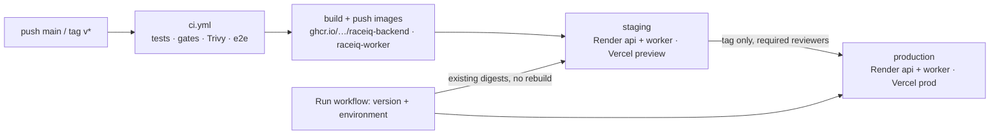

# Deployment (Phase 9)

RaceIQ runs in two environments, **staging** and **production**:
- **Backend:** the API, the worker, PostgreSQL and Key Value (Redis) on **Render**.
- **Frontend:** **Vercel**.
- **Errors:** **Sentry**.

GitHub Actions builds the images once and promotes them. The day-to-day procedures (deploy, roll back, rotate keys) are in [runbook.md](runbook.md).

## Why Render (decision, 2026-10-15)

| Need | Render | Considered |
|---|---|---|
| API + a separate long-running RQ worker | web service + background worker, same image family | Fly.io (machines; more to assemble), Railway (similar, usage-priced) |
| Managed Postgres 16 + Redis with private networking | Render Postgres (daily backups, PITR on paid plans) + Key Value | Fly (Postgres is self-managed), AWS (ECS + RDS + ElastiCache: far more setup) |
| Deploy an exact, scanned image | image-backed services; a deploy hook takes `imgURL=…@sha256:…` | — |
| Migrations before traffic switches | `preDeployCommand` (a failure aborts the deploy and keeps the old version) | — |
| Infrastructure as code | `render.yaml` Blueprint with projects / environments | — |

**Trade-offs we accept:**
- **No TimescaleDB on Render Postgres.** The migration detects that, `telemetry_samples` becomes a plain table, and the repository doesn't depend on Timescale.
- **No shared disk between the API and the worker.** See *Model registry* below.
- **Free instances sleep.** The plans in `render.yaml` are paid starter/standard, because the worker must stay up.

**Frontend on Vercel:** first-class Next.js 16 hosting, preview deployments for staging, and its `/api` rewrite keeps the browser on one origin.

## How the pieces connect

- **The browser only talks to the frontend.** `next.config.ts` rewrites `/api/*` to the environment's API (`BACKEND_URL`, also exported as `NEXT_PUBLIC_API_URL`, set at build time per environment). The refresh cookie (`SameSite=Strict`, path `/api/v1/auth`) therefore stays first-party, and no CORS is needed for the app itself.
- **The API still enforces an origin allowlist.** It checks `FRONTEND_ORIGIN` (set to the Vercel URL) on cookie-authenticated endpoints, and trusts `X-Forwarded-For` from the proxies (`RACEIQ_TRUST_PROXY=true`) for per-IP rate limits.
- **Model registry.** Render serves the registry baked into the image: `models/` goes in at build time through the `models` named build context, with `RACEIQ_MODEL_REGISTRY=file`. A new model ships as a reviewed commit plus a deploy, and the ML regression gate runs on every change. In-app training (`POST /api/v1/admin/models/train`) also needs an S3-compatible bucket shared by the API and the worker (for example Cloudflare R2: `RACEIQ_MODEL_REGISTRY=db`, `RACEIQ_OBJECT_STORE=s3`, `RACEIQ_S3_*`, `AWS_*`). That bucket is optional and not set up.
- **Data.** Sessions live in Postgres (`RACEIQ_STORAGE_BACKEND=postgres`). The pre-deploy seed loads the bundled sample sessions; admins ingest more through the UI (`POST /sessions/{key}/ingest`, run on the worker).

## First deploy (once per environment)

1. **Render:** New → Blueprint → this repository → `render.yaml`.
   - Fill the `sync: false` values when prompted: `FRONTEND_ORIGIN`, `RACEIQ_ADMIN_EMAILS`, and optionally `SENTRY_DSN`, `LLM_*`.
   - `RACEIQ_JWT_SECRET` and `RACEIQ_METRICS_TOKEN` are generated by Render.
2. **Render → Settings → Registry credentials:** add `ghcr-raceiq` (username: the GitHub account; password: a fine-grained PAT with *read:packages*). Not needed if the GHCR packages are public.
3. **Render → each service → Settings → Deploy Hook:** copy the URL.
4. **Vercel:** import the repository with Root Directory `frontend` (`frontend/vercel.json` sets the webpack build). Turn off Vercel's own Git deployments (Settings → Git → Ignored Build Step: `exit 0`), so only the workflow deploys.
5. **GitHub → Settings → Environments:** create `staging` and `production`.
   - **Secrets:** `RENDER_DEPLOY_HOOK_API`, `RENDER_DEPLOY_HOOK_WORKER`, `VERCEL_TOKEN`, `VERCEL_ORG_ID`, `VERCEL_PROJECT_ID`; optionally `VERCEL_AUTOMATION_BYPASS_SECRET` and `SENTRY_AUTH_TOKEN`.
   - **Variables:** `API_URL` (the Render API URL); optionally `APP_DOMAIN`, `SENTRY_DSN_FRONTEND`, `SENTRY_ORG`, `SENTRY_PROJECT`.
   - **On `production`:** add **Required reviewers**, and restrict deployment branches/tags to `v*`.
6. **Push a tag** (`git tag v1.0.0 && git push origin v1.0.0`). Staging deploys automatically; production waits for approval.

Until step 5 is done, pushes to `main` still build and push the images and skip the deploy with an "API KEY NEEDED" warning. Tag pushes fail with the list of missing names (docs/api_keys.md).

## What a deploy does (`.github/workflows/deploy.yml` → `deploy-env.yml`)

1. **CI.** The whole `ci.yml`: tests, coverage, mutation and quality gates, Trivy, compose e2e.
2. **Images.** Builds `raceiq-backend` and `raceiq-worker` with `APP_VERSION` = the tag or `sha-<12>`, pushes them to GHCR as `:<version>` plus `:main` or `:latest-release`, and scans the pushed digests with Trivy.
3. **Per environment:**
   - Render API deploy hook with the exact digest. Render runs the migrations and seed (`preDeployCommand`) and switches traffic only if they pass.
   - Wait until `/api/v1/health` reports the new version, at most 15 min.
   - Deploy the worker.
   - Vercel `pull`, `build` and `deploy --prebuilt`, with that environment's `BACKEND_URL`, release and Sentry DSN.
   - Smoke test through the frontend: `/`, `/api/v1/health` (version match) and `/api/v1/seasons`.
4. **Production.** Only for `v*` tags, after staging succeeds, behind the environment's required reviewers.

**Migrations are expand-only.**
- **Every release must run on the previous release's schema** and vice versa: add columns and tables, never drop or rename in the same release.
- **That is what makes a rollback an image switch.** A destructive change ships in two releases: stop using the column, then drop it.
- **Since Phase 9, `alembic downgrade` is never part of a rollback.**
