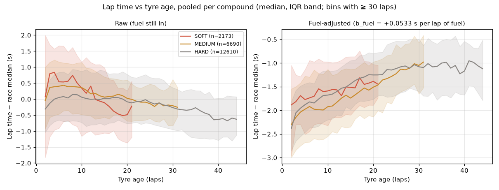
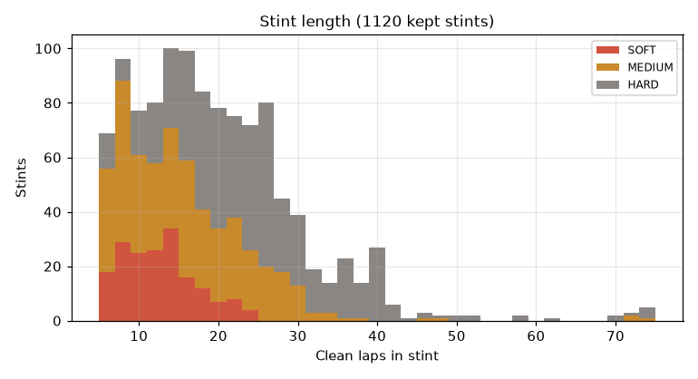
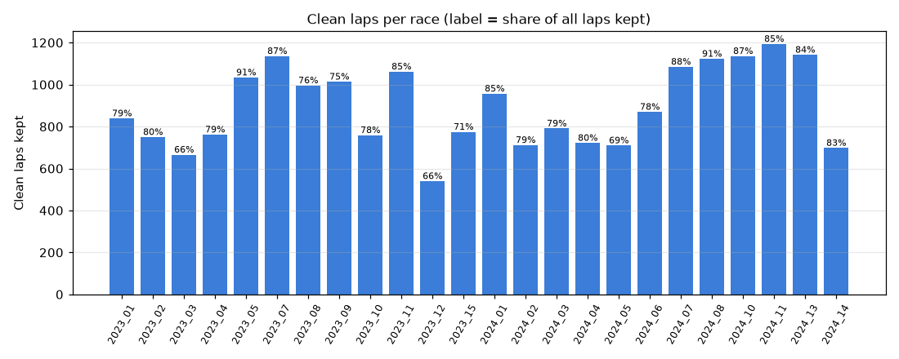
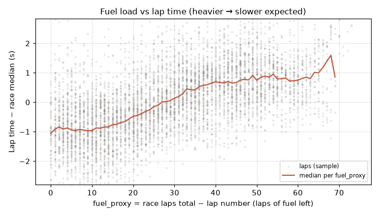

# Tire dataset (Phase 6A)

Generated by `python -m app.tires.report` from the dataset built with `python -m app.tires.dataset build`. One row = one clean race lap for one driver.

The exclusion log and metadata for this build are committed in [`docs/tire_data/`](tire_data/) (the Parquet dataset itself stays in the gitignored `data/tires/`; rebuild it with the command above).

| | |
|---|---|
| Dataset hash | `6681d16a0b578b892423adf8b60c8ab0f800f121b23b7604e13f691997523146` |
| Rows (clean laps) | 21,473 of 26,676 input laps (80.5%) |
| Races included | 24 across seasons 2023, 2024 |
| Races dropped | 0 |
| FastF1 | 3.5.3 · schema v1 · git `bd6940e748` |
| Exclusion config | `{"keep_short_stints": false, "min_clean_stint_laps": 5, "outlier_mad_k": 3.0, "outlier_min_laps": 5}` |

## Exclusions (applied in this order; each lap counted once, by the first rule that drops it)

| # | Rule | Meaning | Dropped | Share of input |
|---|---|---|---|---|
| 1 | `lap_1_or_restart` | Lap 1 and the first lap after a red-flag restart | 558 | 2.1% |
| 2 | `in_or_out_lap` | PitInTime or PitOutTime present | 1,622 | 6.1% |
| 3 | `non_green_track_status` | Track-status set is not exactly {"1"} | 1,371 | 5.1% |
| 4 | `inaccurate_or_deleted` | IsAccurate false, Deleted true, or no LapTime | 330 | 1.2% |
| 5 | `wet_conditions` | Rainfall, or INTERMEDIATE / WET compound | 81 | 0.3% |
| 6 | `unknown_compound` | Compound missing or UNKNOWN / TEST_UNKNOWN | 0 | 0.0% |
| 7 | `stint_outlier` | Slower than stint median + 3 × 1.4826 × MAD (stints ≥ 5 laps) | 945 | 3.5% |
| 8 | `short_stint` | Stint left with < 5 clean laps | 296 | 1.1% |
| | **kept** | | **21,473** | **80.5%** |

Order matters: later rules only see laps the earlier ones kept, so stint_outlier and short_stint judge stints by their already-clean laps, and a lap failing several rules is counted once.

## Per-race retention

| Race | Event | Input laps | Kept | Retention | Largest drop |
|---|---|---|---|---|---|
| 2023_01_R | Bahrain Grand Prix | 1056 | 839 | 79.5% | in_or_out_lap (102) |
| 2023_02_R | Saudi Arabian Grand Prix | 943 | 750 | 79.5% | non_green_track_status (51) |
| 2023_03_R | Australian Grand Prix | 1003 | 666 | 66.4% | non_green_track_status (114) |
| 2023_04_R | Azerbaijan Grand Prix | 962 | 762 | 79.2% | non_green_track_status (91) |
| 2023_05_R | Miami Grand Prix | 1138 | 1034 | 90.9% | in_or_out_lap (40) |
| 2023_07_R | Spanish Grand Prix | 1312 | 1136 | 86.6% | in_or_out_lap (85) |
| 2023_08_R | Canadian Grand Prix | 1317 | 996 | 75.6% | non_green_track_status (157) |
| 2023_09_R | Austrian Grand Prix | 1354 | 1014 | 74.9% | in_or_out_lap (122) |
| 2023_10_R | British Grand Prix | 971 | 759 | 78.2% | non_green_track_status (98) |
| 2023_11_R | Hungarian Grand Prix | 1252 | 1062 | 84.8% | in_or_out_lap (74) |
| 2023_12_R | Belgian Grand Prix | 816 | 540 | 66.2% | wet_conditions (77) |
| 2023_15_R | Singapore Grand Prix | 1088 | 775 | 71.2% | non_green_track_status (180) |
| 2024_01_R | Bahrain Grand Prix | 1129 | 957 | 84.8% | in_or_out_lap (85) |
| 2024_02_R | Saudi Arabian Grand Prix | 901 | 712 | 79.0% | short_stint (52) |
| 2024_03_R | Australian Grand Prix | 998 | 791 | 79.3% | in_or_out_lap (73) |
| 2024_04_R | Japanese Grand Prix | 907 | 722 | 79.6% | in_or_out_lap (72) |
| 2024_05_R | Chinese Grand Prix | 1032 | 710 | 68.8% | non_green_track_status (187) |
| 2024_06_R | Miami Grand Prix | 1111 | 870 | 78.3% | non_green_track_status (100) |
| 2024_07_R | Emilia Romagna Grand Prix | 1238 | 1085 | 87.6% | stint_outlier (59) |
| 2024_08_R | Monaco Grand Prix | 1237 | 1123 | 90.8% | stint_outlier (41) |
| 2024_10_R | Spanish Grand Prix | 1310 | 1136 | 86.7% | in_or_out_lap (84) |
| 2024_11_R | Austrian Grand Prix | 1405 | 1194 | 85.0% | in_or_out_lap (89) |
| 2024_13_R | Hungarian Grand Prix | 1355 | 1142 | 84.3% | in_or_out_lap (81) |
| 2024_14_R | Belgian Grand Prix | 841 | 698 | 83.0% | in_or_out_lap (69) |

## Compound distribution

| Compound | Clean laps | Share | Kept stints |
|---|---|---|---|
| HARD | 12,610 | 58.7% | 524 |
| MEDIUM | 6,690 | 31.2% | 417 |
| SOFT | 2,173 | 10.1% | 179 |

## Sanity plots

**Lap time vs tyre age, pooled per compound (left raw, right fuel-adjusted).**

**Stint length (clean laps per kept stint).**

**Clean laps per race and retention.**

**fuel_proxy vs lap time.**

## Descriptive fuel / tyre-age fit (sanity only, not a model)

OLS with per-race intercepts: `b_fuel = +0.0533 s` per lap of fuel_proxy (positive = heavier car is slower, as expected).

| Compound | Combined adjusted trend (s per lap of tyre age) |
|---|---|
| HARD | +0.0307 |
| MEDIUM | +0.0290 |
| SOFT | +0.0288 |

These slopes are a combined adjusted trend (tire wear + residual track evolution after the fuel adjustment), not pure tire wear. Phase 6B/6C replace this with proper baselines and evaluation.

## Notes and anomalies

<!-- notes:start -->
Reviewed 2026-10-12 against the plots and `exclusion_log_6681d16a0b57.json`.

- **Physically reasonable overall.** With fuel still in (left panel), lap time *falls* with tyre
  age, because fuel burn-off dominates. After the descriptive fuel adjustment (right panel),
  every compound *rises* with tyre age, and no negative-degradation region dominates. The fuel
  plot is monotonic: heavier is slower, at about +0.053 s per lap of fuel, which is in the
  usual range of a few hundredths of a second per lap of fuel.
- **The compound slopes are nearly equal (about +0.03 s per lap each).** Softs would normally
  be expected to degrade fastest. This is a pooled, cross-circuit descriptive fit with known
  selection effects: softs run in short, early, heavy-fuel stints, and hards cover the long
  low-degradation stints, at different circuits. Do not read it as a compound ranking.
  Separating this properly is the job of 6B/6C.
- **The fuel-adjusted panel's absolute level (about −2 s) has no meaning.** The adjustment
  subtracts `b_fuel × fuel_proxy` without re-centring, so only the slope matters.
- **The fuel curve flattens below about 10 laps of fuel** (tyre wear and drivers managing to
  the flag), and the tail above 60 laps of fuel is thin. Only the longest races reach it.
- **The long stints (60–75 clean laps) are real.** 11 drivers in 2024 Monaco ran the whole race
  on one set after the lap-1 red flag. The restart lap is correctly removed by
  `lap_1_or_restart` (36 laps in that race).
- **The lowest-retention races have explained causes, and none was dropped:**
  - 2023 Australia (66%): three red flags, giving 66 restart laps, 114 non-green laps and 57
    short-stint laps.
  - 2023 Belgium (66%): early rain, with 77 laps removed by `wet_conditions`.
  - 2024 China (69%): safety car, with 187 non-green laps.
  - 2023 Singapore (71%): SC/VSC, with 180 non-green laps.

  Retention elsewhere is 74–91%.
- **Checks that held:** `unknown_compound` dropped 0 laps. `traffic_known` is False on every
  row. `prev_lap_time_s` is null on exactly 1,120 rows, one per kept stint (its first clean lap).
  Conservation holds: 21,473 kept + 5,203 dropped = 26,676 input laps.
- **Gate status:** at least 20 races (24) across at least 2 seasons (2023, 2024), and no race
  silently dropped. **Awaiting the human review of this table and the plots before 6B.**
<!-- notes:end -->
