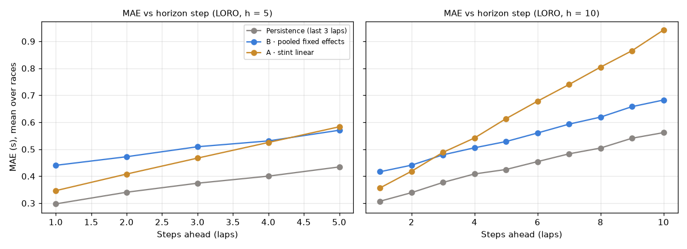
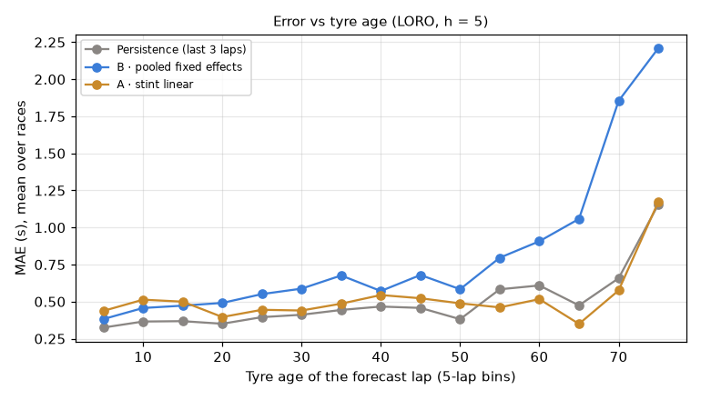
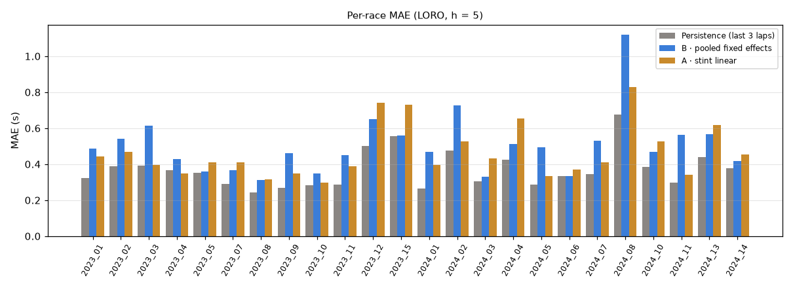

# Tire evaluation harness and benchmarks (Phase 6C)

Code: `backend/app/tires/evaluation.py` (splits, forecast simulation, metrics, aggregation),
`models/persistence.py`, `models/forecasting.py` (the forecasting interface, plus Baselines A and B as
forecasters), and `backend/scripts/run_eval.py` (benchmark run with MLflow logging). Tests:
`tests/test_tires_evaluation.py`.

## What is measured

- **Splits, never random**, both produced by a single `split_generator`:
  - **Leave-one-race-out:** every race is tested once, trained on all the others.
  - **Walk-forward:** races are ordered by (year, round), the calendar order. Each race after
    the first 8 is tested with every earlier race as training data.
- **Forecast simulation:** this is the product's task. Each test stint with ≥ 12 clean laps is
  cut at k = 6, 8, …, n − h. The model sees the first k clean laps and predicts the next
  h ∈ {5, 10}.
- **Information boundary:** `forecast_inputs` is the only way a model sees the future laps.
  - **Masked:** lap times and `prev_lap_time_s`.
  - **Frozen at lap k:** temperatures, rainfall and position.
  - **Assumed:** `laps_since_neutralization` assumes no new safety car.
  - **Passed through:** only deterministic columns (lap number, tyre age, compound, stint, and
    `fuel_proxy` from the known race length).

  A test mutates every lap after k and asserts that predictions do not change, for all three
  benchmarks. It also checks that changing the history does change them, so the test can't
  pass vacuously.
- **No leakage through coefficients:** every fuel and degradation coefficient is fitted on the
  training races only. (In 6B, A borrowed β_fuel from a same-race fit. In forecasting that would
  have leaked the test race's future.)
- **Metrics:** MAE, RMSE and bias (predicted − actual) per horizon step. For models with
  intervals: coverage, mean width and the Gneiting–Raftery interval score. Also a slope check
  against each long stint's own ex-post OLS slope, which is **a reference, not ground truth**.
- **Aggregation:** every number is the **mean over races** with its standard error across races,
  never a pooled mean over laps, so long races do not dominate. A test pins this down on a
  deliberately unbalanced case.

## Benchmarks

<!-- benchmarks:start -->
Generated by `python -m scripts.run_eval`: dataset `6681d16a0b57`, git `3ec004581c`, MLflow run `ed7845f3fd18495ab393905995bf4d46`.

Lap-time forecast error in seconds; mean over races (± standard error across races). Bias = predicted − actual (> 0: forecasts too slow). Slope vs ref = mean |forecast slope − stint's ex-post OLS slope| on stints ≥ 15 laps (a reference, not ground truth).

| Split | h | Model | Races | MAE | RMSE | Bias | 95% PI coverage | PI width | Slope vs ref (s/lap) |
|---|---|---|---|---|---|---|---|---|---|
| loro | 5 | Persistence (last 3 laps) | 24 | **0.369** ± 0.021 | 0.500 | +0.013 ± 0.031 | — | — | 0.039 |
| loro | 5 | A · stint linear | 24 | **0.466** ± 0.030 | 0.637 | +0.007 ± 0.033 | 88% | 2.10 | 0.099 |
| loro | 5 | B · pooled fixed effects | 24 | **0.505** ± 0.034 | 0.635 | -0.073 ± 0.081 | — | — | 0.041 |
| loro | 10 | Persistence (last 3 laps) | 24 | **0.440** ± 0.026 | 0.577 | +0.055 ± 0.051 | — | — | 0.039 |
| loro | 10 | B · pooled fixed effects | 24 | **0.548** ± 0.038 | 0.686 | -0.060 ± 0.093 | — | — | 0.041 |
| loro | 10 | A · stint linear | 24 | **0.645** ± 0.054 | 0.886 | +0.037 ± 0.057 | 84% | 2.56 | 0.099 |
| walk_forward | 5 | Persistence (last 3 laps) | 16 | **0.390** ± 0.029 | 0.527 | -0.012 ± 0.038 | — | — | 0.040 |
| walk_forward | 5 | A · stint linear | 16 | **0.503** ± 0.041 | 0.678 | +0.013 ± 0.047 | 88% | 2.20 | 0.107 |
| walk_forward | 5 | B · pooled fixed effects | 16 | **0.536** ± 0.043 | 0.676 | -0.123 ± 0.102 | — | — | 0.045 |
| walk_forward | 10 | Persistence (last 3 laps) | 16 | **0.464** ± 0.035 | 0.611 | +0.023 ± 0.064 | — | — | 0.040 |
| walk_forward | 10 | B · pooled fixed effects | 16 | **0.584** ± 0.047 | 0.731 | -0.119 ± 0.118 | — | — | 0.045 |
| walk_forward | 10 | A · stint linear | 16 | **0.712** ± 0.074 | 0.969 | +0.062 ± 0.082 | 82% | 2.70 | 0.107 |

MAE by horizon step (LORO):

| h | Model | step 1 | step 2 | step 3 | step 4 | step 5 | step 6 | step 7 | step 8 | step 9 | step 10 |
|---|---|---|---|---|---|---|---|---|---|---|---|
| 5 | Persistence (last 3 laps) | 0.297 | 0.341 | 0.374 | 0.400 | 0.434 |  |  |  |  |  |
| 5 | B · pooled fixed effects | 0.440 | 0.472 | 0.509 | 0.531 | 0.570 |  |  |  |  |  |
| 5 | A · stint linear | 0.346 | 0.408 | 0.467 | 0.525 | 0.583 |  |  |  |  |  |
| 10 | Persistence (last 3 laps) | 0.307 | 0.339 | 0.377 | 0.408 | 0.425 | 0.454 | 0.483 | 0.504 | 0.541 | 0.562 |
| 10 | B · pooled fixed effects | 0.417 | 0.441 | 0.479 | 0.505 | 0.528 | 0.560 | 0.593 | 0.619 | 0.658 | 0.682 |
| 10 | A · stint linear | 0.357 | 0.418 | 0.488 | 0.542 | 0.613 | 0.678 | 0.740 | 0.804 | 0.865 | 0.942 |

MAE by compound (LORO, h = 5):

| Model | SOFT | MEDIUM | HARD |
|---|---|---|---|
| Persistence (last 3 laps) | 0.402 (15) | 0.362 (22) | 0.373 (23) |
| B · pooled fixed effects | 0.498 (15) | 0.474 (22) | 0.507 (23) |
| A · stint linear | 0.489 (15) | 0.496 (22) | 0.468 (23) |

(Bracketed: number of races contributing to that compound.)
<!-- benchmarks:end -->

## Interpretation

- **Persistence is the best benchmark everywhere.** That is under both splits, both horizons,
  every horizon step, every compound, and nearly every race. Leave-one-race-out at h = 5:
  **0.369 ± 0.021 s**, against 0.466 for A and 0.505 for B. The plan's warning held: a stint's
  last three laps are a strong predictor of its next few, and neither interpretable baseline
  beats that.
- **Why B loses:**
  - **Lagging level:** it anchors the stint's level on the mean of *all* history laps, so it
    lags. Its step-1 error is already 0.44 s against persistence's 0.30 s.
  - **Extrapolated pooled slopes:** it extrapolates pooled cross-race slopes, and its error
    explodes beyond about 55 laps of tyre age. That is the 2024 Monaco one-set stints, where
    pace management, not wear, drives lap time.
  - **Bias:** it runs slightly fast (bias −0.07 s LORO, −0.12 s walk-forward).

  Anchoring on recent laps is an obvious fix, but it is deliberately **not** applied here.
  Tuning a benchmark on the evaluation data would quietly move the 6D target. It belongs to 6D
  model work.
- **Why A loses:** its per-stint slope comes from as few as 6 noisy laps, so the extrapolation
  error grows fastest with the horizon (0.35 s at step 1, 0.94 s at step 10).
- **A's 95% intervals under-cover:** 82–88% instead of 95%. Its residuals are not independent
  within a stint, and the borrowed fuel slope's uncertainty is ignored. Calibrated intervals are
  a 6D deliverable, and this is the bar they must clear.
- **The slope reference** sits near 0 (persistence's flat forecast scores 0.039 s/lap against
  it). Within a stint the raw lap-time trend is degradation *minus* fuel burn-off, and the two
  nearly cancel. This is why the plan labels it a reference, not ground truth. Fuel-adjusted
  degradation can only be judged across stints (6B), not from one stint's raw trend.
- **Walk-forward** (16 races, trained only on earlier ones) tells the same story with slightly
  higher errors, which is expected with less training data.

## 6D success bar

Status: **agreed 2026-10-12** (human gate passed). 6D must meet every line below.

| # | Criterion | Value it must beat |
|---|---|---|
| 1 | h = 5 MAE under leave-one-race-out at least **10% lower** than the best benchmark | Persistence 0.369 s, so **≤ 0.332 s** |
| 2 | Mean bias within **±0.05 s** (LORO, h = 5) | Persistence +0.013, A +0.007, B −0.073 |
| 3 | Not worse than persistence under walk-forward, h = 5 | **≤ 0.390 s** |
| 4 | Lower MAE than persistence in a **majority of races** (paired, LORO, h = 5), so the gain is not a few races | ≥ 13 of 24 races |
| 5 | For models that publish intervals: 95% interval coverage **90–97%** | A reaches 82–88% |

The standard error of the race-mean MAE is about 0.02 s, so a 10% (0.037 s) improvement is
roughly 1.8 standard errors. Criterion 4 guards against a gain that comes from a handful of
races.

## Reproducing

    git checkout 3ec0045                      # the recorded git SHA (clean tree)
    cd backend && python -m app.tires.dataset build --seasons 2023 2024   # hash 6681d16a0b57…
    python -m scripts.run_eval                # MLflow experiment raceiq-tires (mlruns/mlflow.db)

The MLflow run `ed7845f3fd18495ab393905995bf4d46` records the dataset hash, git SHA, FastF1
version, 13 parameters, 84 metrics, the four result tables and the three plots.

