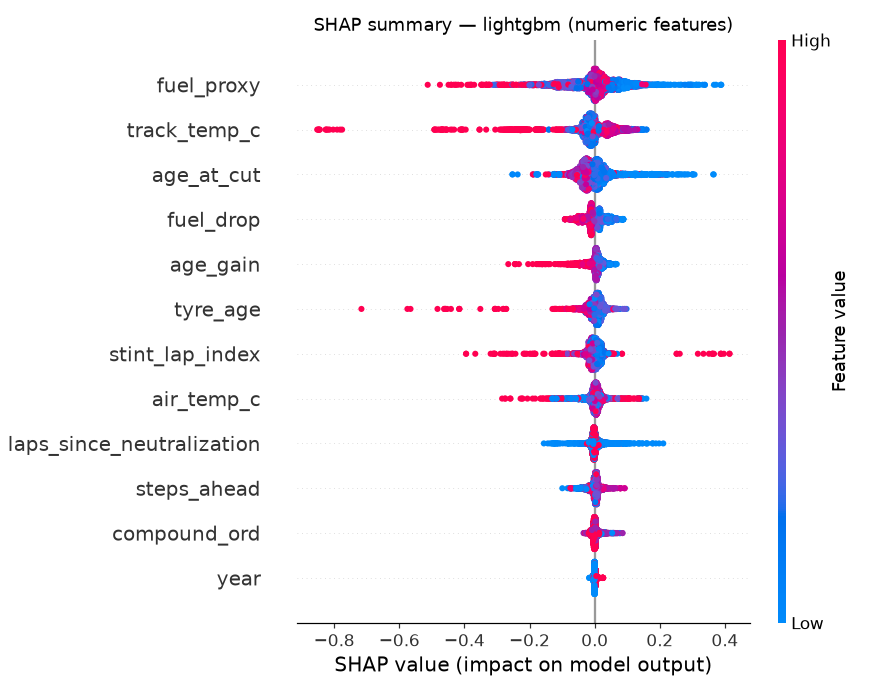
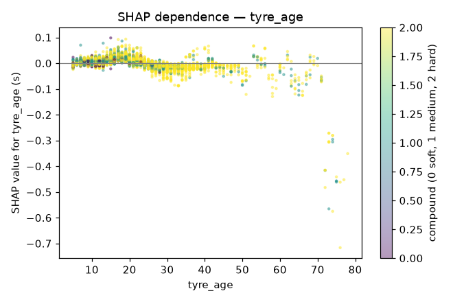
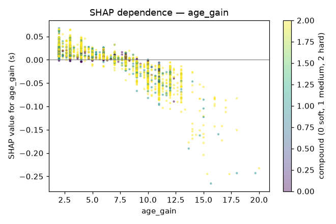

# Tire model report (Phase 6D)

**Status: awaiting human review.** No model met the agreed bar. As the decision protocol requires,
the shipped artifact is **Baseline B with split-conformal intervals**. On the held-out races that
fallback misses the 80% coverage acceptance band and is less accurate than persistence. See
[Decision](#decision-and-what-needs-review): the reviewer should confirm or change the shipped
model before the service is built.

Dataset `6681d16a0b57` (24 dry races, 21,473 clean laps; `docs/tire_dataset.md`). Code:
`backend/app/tires/` (`features.py`, `models/tree_models.py`, `tuning.py`, `models/intervals.py`,
`degradation.py`, `explain.py`, `bar.py`, `artifacts.py`). Runner: `backend/scripts/run_6d.py`
(stages `defaults`, `tuned`, `intervals`, `explain`, `final`). Each stage refuses a dirty git tree,
saves its result to `data/tires/eval/`, then logs to the MLflow experiment `raceiq-tires`.

| Stage | Git | MLflow run |
|---|---|---|
| defaults | `6265a64` | `6ee74895a5d04ca28b1e75b3b89b6ae5` |
| tuned (nested) + full-development search | `8b50a9d` | `2483bede8c1a49448380f9551fc83d2c`, `6d-tuning-search-6681d16a0b57` (40 nested trial runs) |
| intervals | `8b50a9d` | `7eeeb5dab9534701b30e67fab03958c5` |
| explain (SHAP, degradation) | `8d38701` | — (JSON in `data/tires/eval/6d_explain_*.json`) |
| final (holdout, once) | `4d856cb` | `04535601eb5d4a0baff6244092a36c15` |

## Protocol

- **Holdout:** the last 3 races by date, `2024_11_R` (Spielberg), `2024_13_R` (Budapest) and
  `2024_14_R` (Spa). They were split off before any 6D model was fitted, and they were evaluated
  exactly once, in `final`. That stage is the only code path that reads them (`split_holdout`).
- **Development:** the other 21 races. They are evaluated with the 6C harness: leave-one-race-out
  (LORO) and walk-forward (WF, ≥ 8 earlier races), forecast cuts k = 6, 8, …, horizons
  h ∈ {5, 10}, and every number is a mean over races ± standard error.
- **Bar:** during development the agreed bar is checked *relative* to persistence on the same 21
  races (MAE ≤ 0.9 × persistence, WF ≤ persistence). The absolute numbers (≤ 0.332 s, ≤ 0.390 s)
  were set on all 24 races and are checked on the holdout.
- **Coverage:** judged against the interval's nominal level. 80% intervals must cover 72–88%
  (the 6D acceptance criterion) and 95% intervals must cover 90–97% (bar item 5).

## Target and features

The trees predict **lap time − anchor**, where the anchor is the mean of the last 3 history laps
(`ANCHOR_LAPS = 3`), and they add the anchor back. Predicting raw lap time would make the model
learn each circuit's level, which persistence gets for free. Anchoring makes every tree a
correction to persistence.

| Feature | Notes |
|---|---|
| `tyre_age`, `age_at_cut`, `age_gain` | age of the predicted lap, age at the cut, laps since the cut |
| `fuel_proxy`, `fuel_drop` | laps remaining; laps of fuel burned since the cut |
| `steps_ahead`, `stint_lap_index` | projected from the cut, never read from future rows |
| `compound_ord` | SOFT 0 < MEDIUM 1 < HARD 2 |
| `track_temp_c`, `air_temp_c`, `laps_since_neutralization` | frozen or projected at the cut (6C information boundary) |
| `year`, `circuit` | `circuit` is one-hot, or native categorical for LightGBM |
| `driver`, `team` | the `+identity` variants only |

- **Fold safety:** encoders are fitted on the training fold only. An unseen circuit or driver is
  encoded as unknown, never learned.
- **One builder:** training rows and forecast rows come from the same function, so training and
  serving can't drift apart.
- **Tests:** `tests/test_tires_features.py`. The 6C information-boundary test passes for all
  4 models × 2 variants: mutating every lap after the cut leaves the forecast unchanged.

## Model comparison (development races, library defaults)

| Model | LORO h=5 MAE | LORO h=5 bias | WF h=5 MAE | LORO h=10 MAE | WF h=10 MAE |
|---|---|---|---|---|---|
| **persistence** | **0.369** ± 0.024 | +0.024 | **0.394** ± 0.035 | **0.440** ± 0.029 | **0.469** ± 0.042 |
| gradient_boosting | 0.403 ± 0.028 | +0.010 | 0.408 ± 0.037 | 0.468 ± 0.032 | 0.480 ± 0.042 |
| gradient_boosting+identity | 0.395 ± 0.026 | +0.009 | 0.407 ± 0.036 | 0.464 ± 0.031 | 0.481 ± 0.040 |
| lightgbm | 0.400 ± 0.025 | −0.052 | 0.430 ± 0.028 | 0.467 ± 0.030 | 0.518 ± 0.036 |
| lightgbm+identity | 0.406 ± 0.026 | −0.062 | 0.426 ± 0.030 | 0.479 ± 0.032 | 0.513 ± 0.039 |
| random_forest | 0.430 ± 0.025 | +0.050 | 0.431 ± 0.033 | 0.500 ± 0.032 | 0.500 ± 0.037 |
| random_forest+identity | 0.418 ± 0.026 | +0.034 | 0.425 ± 0.034 | 0.495 ± 0.034 | 0.498 ± 0.038 |
| xgboost | 0.440 ± 0.032 | +0.002 | 0.462 ± 0.042 | 0.514 ± 0.040 | 0.539 ± 0.050 |
| xgboost+identity | 0.423 ± 0.028 | +0.014 | 0.437 ± 0.037 | 0.493 ± 0.032 | 0.507 ± 0.045 |

At library defaults, no tree beats persistence on mean MAE, and none wins more than 7 of 21
races. Identity features help Random Forest and XGBoost slightly and LightGBM not at all.

## Tuning (nested) and the monotone experiment

`TunedForecaster` runs a seeded random search with 20 trials (library defaults are always
trial 0). Each trial is scored by `GroupKFold(3)` *by race* on the training races it is given.
Because the harness calls `fit()` once per outer fold, the search is nested: a test race never
influences its own hyperparameters (`test_tuning_is_nested_inside_the_training_races`). The tuned
variants carry no identity features, since identity did not help LightGBM at defaults.

| Model | LORO h=5 MAE | bias | WF h=5 MAE | LORO h=10 | WF h=10 | Races beating persistence |
|---|---|---|---|---|---|---|
| persistence | 0.369 ± 0.024 | +0.024 | 0.394 ± 0.035 | 0.440 | 0.469 | — |
| xgboost+tuned | 0.383 ± 0.024 | −0.013 | 0.404 ± 0.034 | 0.449 | 0.472 | 11/21 |
| lightgbm+tuned | 0.393 ± 0.029 | −0.072 | 0.416 ± 0.030 | 0.454 | 0.500 | 12/21 |
| lightgbm+monotone | 0.402 ± 0.025 | −0.050 | 0.425 ± 0.030 | 0.468 | 0.513 | 7/21 |

- **Tuning helps:** XGBoost improves from 0.440 to 0.383, and the tuned models now beat
  persistence in a majority of races.
- **But not enough:** they still fail bar items 1 and 3. LightGBM also fails item 2 (bias).
- **One race drives the miss:** Budapest 2023 (`2023_11_R`). There the tuned trees are 0.24 s
  (XGBoost) to 0.50 s (LightGBM) worse than persistence. On every other development race they
  are within about ±0.1 s of it. Budapest 2023 is the hottest race in the dataset (track
  45.7–50.1 °C, the dataset maximum). `track_temp_c` is the second-largest numeric SHAP feature,
  and a tree cannot extrapolate beyond the temperatures it was trained on.
- **Monotone experiment:** constraining the prediction to be non-decreasing in `tyre_age` and
  `age_gain` makes LightGBM worse (0.402 vs 0.400 at defaults). Within a stint lap times
  *fall*, because fuel burn-off beats wear (next section), so forcing them to rise works against
  the data.
- **Full-development search** (for the hyperparameters used by the intervals, SHAP and reference
  rows):
  - LightGBM: inner-CV MAE 0.459 vs 0.466 at defaults, with `n_estimators=600,
    learning_rate=0.02, num_leaves=15, min_child_samples=100, reg_lambda=5`.
  - XGBoost: inner-CV MAE 0.450 vs 0.532 at defaults, with `n_estimators=100,
    learning_rate=0.05, max_depth=6, min_child_weight=20, subsample=0.7,
    colsample_bytree=0.7, reg_lambda=5`.

  Every trial is in `data/tires/eval/6d_tuning_trials_*.json` and in MLflow.

### Bar verdicts (development, relative)

| Model | 1 MAE ≤ 0.9 × persistence (0.332) | 2 abs(bias) ≤ 0.05 | 3 WF ≤ persistence (0.394) | 4 majority | Passes |
|---|---|---|---|---|---|
| xgboost+tuned | ❌ 0.383 | ✅ −0.013 | ❌ 0.404 | ✅ 11/21 | no |
| lightgbm+tuned | ❌ 0.393 | ❌ −0.072 | ❌ 0.416 | ✅ 12/21 | no |
| gradient_boosting+identity (best default) | ❌ 0.395 | ✅ +0.009 | ❌ 0.407 | ❌ 6/21 | no |

## Intervals

There are two methods.

- **Split-conformal** wraps any point model. Inside `fit(train)` the most recent 30% of the
  training races (by date) are held out for calibration. The model is fitted on the earlier
  races. The absolute residuals on the calibration races then give a finite-sample quantile
  **per horizon step**: rank ⌈(n+1)(1−α)⌉, and the error grows with the step.
- **LightGBM quantile** fits α/2 and 1−α/2 quantile regressions on the anchored target.

Both repair crossings, so lo ≤ prediction ≤ hi. The choice is made under walk-forward, where
calibration races are always earlier than the test race, as they would be in production.

| Method | WF h=5 coverage | WF h=5 width (s) | LORO h=5 coverage | LORO h=5 width |
|---|---|---|---|---|
| persistence + conformal 80% | 76.7% ✅ | **1.130** | 86.2% | 1.392 |
| lightgbm (tuned) + conformal 80% | 77.8% ✅ | 1.248 | 85.7% | 1.427 |
| Baseline B + conformal 80% | 77.7% ✅ | 1.538 | 88.4% | 1.960 |
| lightgbm (tuned) quantile 80% | 70.1% ❌ | 0.982 | 73.9% | 1.015 |
| persistence + conformal 95% | 92.4% ✅ | 2.151 | 97.3% | 2.762 |
| lightgbm (tuned) + conformal 95% | 93.0% ✅ | 2.245 | 97.1% | 2.769 |
| Baseline B + conformal 95% | 91.7% ✅ | 2.610 | 97.1% | 3.475 |

At h = 10, walk-forward coverage is 75.7–79.5% (80%) and 92.2–94.1% (95%) for every conformal
method. Quantile LightGBM under-covers (66–71%).

- **Choice:** split-conformal is calibrated and quantile regression is not. By the plan's rule
  (within tolerance, then narrowest), the interval method is **conformal**, and with persistence
  as the point model it is also the narrowest.
- **LORO runs wider:** LORO calibrates on the most recent races even when the test race is
  earlier, which is not exchangeable. That is why it over-covers slightly (97% for 95%).

## Holdout: the single final evaluation

Training is on all 21 development races, and each held-out race is tested once.

| Model | h=5 MAE | h=5 bias | h=10 MAE | h=5 coverage | h=5 width | Spielberg / Budapest / Spa |
|---|---|---|---|---|---|---|
| persistence | **0.372** | −0.063 | **0.440** | — | — | 0.298 / 0.440 / 0.378 |
| persistence + conformal 80% | 0.372 | −0.063 | 0.440 | **87.4%** ✅ | 1.408 | |
| persistence + conformal 95% | 0.372 | −0.063 | 0.440 | 98.4% ❌ | 2.798 | |
| xgboost (tuned, refit) | 0.380 | −0.052 | 0.447 | — | — | 0.314 / 0.436 / 0.389 |
| xgboost + conformal 80% | 0.392 | −0.058 | 0.466 | 86.7% ✅ | 1.428 | |
| xgboost + conformal 95% | 0.392 | −0.058 | 0.466 | 98.3% ❌ | 2.848 | |
| Baseline B | 0.520 | −0.301 | 0.571 | — | — | 0.570 / 0.573 / 0.416 |
| **Baseline B + conformal 80% (shipped)** | 0.505 | −0.300 | 0.551 | 91.5% ❌ | 1.989 | 0.550 / 0.567 / 0.398 |
| Baseline B + conformal 95% | 0.505 | −0.300 | 0.551 | 98.8% ❌ | 3.525 | |

- **Absolute bar:** no model passes (≤ 0.332 s, |bias| ≤ 0.05, ≤ 0.390 s, majority of the 3
  races). Persistence itself scores 0.372, in line with its 6C value of 0.369.
- **Baseline B is clearly worst:** its bias is −0.30 s, which means it predicts too fast. It
  extrapolates pooled cross-race slopes, and it anchors on the mean of all history laps (6C
  analysis).
- **Holdout coverage:** with 3 races this is a noisy estimate.
  - The 80% conformal intervals of persistence and XGBoost land inside 72–88%.
  - Baseline B's lands above, at 91.5%: its intervals are too wide.
  - Every 95% interval over-covers (98%).
- **Why the B rows differ:** the "+conformal" variants fit their point model on 70% of the
  training races, so their MAE differs a little from the plain model's.

## SHAP (tuned LightGBM, fitted on the 21 development races)

Mean |SHAP| (s), with one-hot columns summed back into their feature:

| circuit | fuel_proxy | track_temp_c | age_at_cut | fuel_drop | age_gain | tyre_age | stint_lap_index | air_temp_c | laps_since_neutralization | steps_ahead | compound_ord | year |
|---|---|---|---|---|---|---|---|---|---|---|---|---|
| 0.185 | 0.057 | 0.041 | 0.033 | 0.022 | 0.018 | 0.016 | 0.016 | 0.015 | 0.012 | 0.010 | 0.007 | 0.002 |

- **Ranking:** circuit dominates: how far a stint's next laps move from its last three depends
  mostly on the track. Fuel and temperature come next. Identity is not in this model, so its
  share is 0%. In the `+identity` variants, identity did not improve accuracy either.
- **The tyre_age sign check fails, for a documented reason.** The plan expects a positive
  tyre_age effect. Spearman(feature, SHAP) is −0.49 for `tyre_age` and −0.87 for both `age_gain`
  and `fuel_drop`. In every row `age_gain ≡ fuel_drop`
  (`test_age_gain_and_fuel_drop_are_identical_in_every_row`), and within a stint lap times fall,
  because fuel burn-off (≈ 0.054 s per lap of fuel, Baseline B) beats wear (≈ 0.03–0.06 s/lap).
  The model learns the net within-stint trend correctly. That trend is negative, and no tree can
  split it into wear and fuel without the across-stint identification Baseline B uses (6B).
  `tyre_age` across stints is also confounded with race progress: later stints run on emptier
  cars and a more rubbered-in track.

## Degradation per lap

Plan deviation, which is also documented in `degradation.py`: the plan asks for the tree
prediction with fuel held fixed. With `age_gain ≡ fuel_drop` in every row, that counterfactual is
arbitrary, because the tree may have split on either column. The tree estimate is therefore the
within-stint slope of the predicted next 5 laps plus β_fuel from Baseline B fitted on the same
races. Uncertainty comes from 30 bootstrap resamples over training races. Estimates outside
−0.05…+0.5 s/lap carry `implausible_estimate`.

Barcelona 2024 (`2024_10_R`), models fitted on the other 20 development races, first 10 laps
of each stint as history:

| Driver | Stint | Compound | Tree estimate (s/lap) | 95% bootstrap CI | Flags | Baseline B at that age |
|---|---|---|---|---|---|---|
| ALB | 2 | SOFT | +0.043 | −0.002 … +0.074 | — | +0.062 |
| ZHO | 2 | MEDIUM | +0.040 | +0.018 … +0.057 | — | +0.031 |
| BOT | 3 | HARD | +0.037 | +0.018 … +0.054 | — | +0.030 |

All three estimates are plausible and agree with Baseline B within their intervals. On synthetic
races with known slopes, the estimator recovers MEDIUM and HARD within 0.03 s/lap (tested).

## Decision and what needs review

**Protocol outcome.** "Ship the simplest model that meets the bar; otherwise ship Baseline B
with conformal intervals." No model met the bar on the development races. The fallback is
therefore shipped:

- Model: `pooled_fixed_effects+conformal80`, refitted on all 24 races.
- Artifact: `data/tires/models/tire_model_6681d16a0b57_4d856cb15f.pkl`.
- Metadata: `docs/tire_model_metadata.json`, which records the dataset hash, git SHA, features,
  per-step 80% quantiles, 95% quantiles and calibration residuals.

**Acceptance against the plan.**

| Criterion | Result |
|---|---|
| 80% coverage 72–88% on held-out races (shipped model) | ❌ 91.5% (persistence + conformal: ✅ 87.4%) |
| Artifacts with dataset hash and git SHA | ✅ |
| Report written | ✅ this document |
| Nested tuning with GroupKFold by race, ≤ 50 trials, logged | ✅ 20 trials |
| Leakage tests (encoders, information boundary, nesting) | ✅ |

**Recommendation for the reviewer (not applied).** Ship **persistence + split-conformal (80%,
with the 95% quantiles in the metadata)** instead of the fallback. On every split and on the
holdout it is the most accurate model, its 80% interval is the narrowest calibrated one, and it
meets the coverage acceptance criterion.

The fallback exists because Baseline B is interpretable and gives degradation estimates. Those
estimates can still be served from Baseline B, or from the tree estimator above, alongside a
persistence forecast. That keeps the forecast and the degradation number as separate outputs.

Switching is a one-line change: `python -m scripts.run_6d final --ship persistence`. But it
would re-touch the holdout, which this protocol allows only once. The numbers above already
contain persistence's holdout result, so the decision can be made without another run.

## Limitations

- **Fuel and wear are not separable within a stint.** Fuel and track evolution are confounded
  with tyre age (6B). Every degradation number depends on Baseline B's across-stint
  identification of β_fuel.
- **Dry races only, no traffic and no tyre temperatures.** There is no reliable gap data
  (`traffic_known = False`). Dirty-air and tyre-temperature effects show up as noise.
- **Temperature extrapolation.** Trees can't extrapolate beyond the training range of
  `track_temp_c` (Budapest 2023). More hot races, or a linear temperature term, would be needed.
- **Small samples.** 21 development races and 3 holdout races. Holdout coverage and the
  "majority of races" check (out of 3) are coarse.
- **Fuel proxy is in laps,** not kg. The race length comes from FastF1's scheduled distance.
- **Artifact size:** the Baseline B pickle is 119 MB because statsmodels keeps the training
  design matrices. It also must be unpickled from inside a function: patsy captures the caller's
  frame. The service phase should store only the coefficients.
